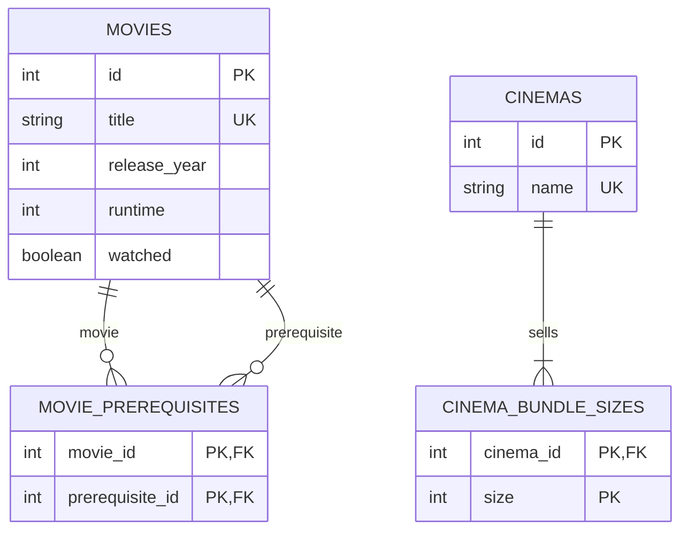

# Doomsday Ready

Doomsday Ready helps MCU fans plan a rewatch before *Avengers: Doomsday*. Add movies and the movies that come before them, mark what you have watched, and check how much time is left. You can also add a cinema’s seat bundles and find the smallest exact set for your group.

This project was built for the Blinto Full Stack Developer Internship assessment. The sample movie links are challenge data, not an official MCU watch guide.

## What the assessment asks for

The app has three views:

- **Movies:** Add movies, change their prerequisites, mark them watched or unwatched, and delete movies that no other movie depends on.
- **Rewatch Plan:** Choose a target movie and see every prerequisite once, in watch order. The plan shows watched progress and the remaining runtime.
- **Booking:** Choose a cinema, enter a group size, and see the fewest seat bundles that fit exactly, or “Not possible.”

The API supports the same movie, rewatch, cinema, and booking tasks. Movie cycles return `409 CIRCULAR_DEPENDENCY`. A movie that another movie needs cannot be deleted; that request returns `409 MOVIE_IS_PREREQUISITE`.

## Technology

- **Frontend:** React, Vite, Tailwind CSS, and GSAP
- **Backend:** Node.js and Express
- **Database:** PostgreSQL on Neon, accessed with `pg` and plain SQL

The cycle check, prerequisite traversal, and minimum-bundle calculation are written in JavaScript in `server/src/logic.js`. They do not use recursive SQL or a library that solves those problems.

## Set up locally

You need Node.js 20 or newer, npm, and a Neon PostgreSQL database.

1. Clone the repository and open its root folder:

   ```sh
   git clone https://github.com/Ismam0044/Doomsday-Ready.git
   cd Doomsday-Ready
   ```

2. Copy `.env.example` to `.env`.

   In PowerShell:

   ```powershell
   Copy-Item .env.example .env
   ```

   In macOS, Linux, or a shell with `cp`:

   ```sh
   cp .env.example .env
   ```

3. Open `.env`. Replace the `DATABASE_URL` example with your Neon connection string. Keep the local API port as `PORT=3001`. Do not commit `.env`; it contains your database credentials.

   The app enables SSL for non-local PostgreSQL connections. A Neon connection string should include its SSL setting.

4. Install the exact dependencies recorded in the lock file:

   ```sh
   npm ci
   ```

5. Create the tables and add the eight sample movies:

   ```sh
   npm run setup
   ```

   This command connects to the database in `DATABASE_URL`. It creates the schema if needed and skips sample movies or prerequisite links that are already present. It does not reset the database.

6. Start the API and frontend together:

   ```sh
   npm run dev
   ```

   Open these pages in your browser:

   - Movies: <http://localhost:5173/>
   - Rewatch Plan: <http://localhost:5173/rewatch.html>
   - Booking: <http://localhost:5173/booking.html>

   The API listens on port `3001`. Vite forwards `/api` requests to it. `PORT` in `.env` sets the API port; the frontend development server uses port `5173`.

To stop the local servers, press **Ctrl+C** in the terminal running `npm run dev`.

## How to use it

1. On **Movies**, add the movies you want to track. Choose any movies that should be watched first. Open **Edit prerequisites** later to change those links. Use the checkmark to update watched status.
2. Open **Rewatch Plan**, choose a target, and follow the prerequisite order. The target itself is left out. The watched count, progress bar, and time remaining update as you mark movies watched.
3. On **Booking**, add a cinema and its different bundle sizes, such as `2, 5`. Choose that cinema, enter your group size, and request a quote. The result uses the fewest bundles that seat everyone exactly.

## API reference

All endpoints use the `/api` prefix.

| Method and path | What it does |
| --- | --- |
| `POST /api/movies` | Add a movie, with optional prerequisites. |
| `GET /api/movies` | List movies and their prerequisites. |
| `PATCH /api/movies/:id` | Update movie details, prerequisites, or watched status. |
| `DELETE /api/movies/:id` | Delete a movie if no other movie uses it as a prerequisite. |
| `GET /api/movies/:id/rewatch-order` | Get the target’s prerequisite-first watch order and progress totals. |
| `POST /api/cinemas` | Add a cinema and its bundle sizes. |
| `GET /api/cinemas` | List cinemas and their bundle sizes. |
| `GET /api/cinemas/:id/booking?groupSize=6` | Get the smallest exact booking quote, or a not-possible result. |

The API checks movie runtime (1–300 minutes), release year (1888–2200), cinema bundle count (1–10 different sizes), bundle size (1–500 seats), and group size (1–10,000 people). Movie titles and cinema names must be unique. Watched status starts as `false` unless it is updated.

## Data model



## Assumptions

- The assessment does not set release years or runtimes for its sample movies. The sample values are in `server/src/sample-data.js`. The app accepts release years from 1888 through 2200 and runtimes from 1 through 300 minutes. The 2026 release year and 180-minute runtime for *Avengers: Doomsday* are assumptions.
- When more than one valid rewatch order exists, the app returns a valid depth-first order. If several bundle combinations use the same minimum number of bundles, it returns the first minimum solution found by the dynamic program.
- PostgreSQL compares unique titles and cinema names using its default case-sensitive comparison.
- Prerequisite links use `ON DELETE NO ACTION`. The API rejects deleting a movie that another movie depends on and removes only the deleted movie’s own prerequisite links.

## Run checks and build

Run the automated logic and HTTP API tests:

```sh
npm test
```

The tests use a mocked database pool; they do not need to connect to Neon.

Build the frontend for production:

```sh
npm run build
```

After building, `npm start` runs the Express server, which also serves the built frontend. It uses `PORT` from `.env` and defaults to `3001`.

## Docker Compose

With Docker Desktop running and `.env` configured, start the frontend and API with one command:

```sh
docker compose up --build
```

Open <http://localhost:5173/>. The API is available at <http://localhost:3001/>. Compose starts only the app containers; PostgreSQL remains on Neon. Press **Ctrl+C** to stop the services.

## Deploy on Vercel

The live site is <https://doomsday-ready-one.vercel.app>.

Import the repository root as a single Vercel project. The root `vercel.json` selects the container setup, and `Dockerfile.vercel` builds the frontend and runs it with the Express API. Add `DATABASE_URL` to the project’s Production environment variables in Vercel. Keep the real connection string out of Git. The Vercel container listens on port `80`; the local `PORT=3001` setting is for development and Docker Compose.

Repository: <https://github.com/Ismam0044/Doomsday-Ready>

## AI tools

AI tools helped review the assessment, plan the work, draft parts of the app, and check behavior against the expected results. The movie traversal, cycle check, and bundle calculation are project code written in JavaScript.
