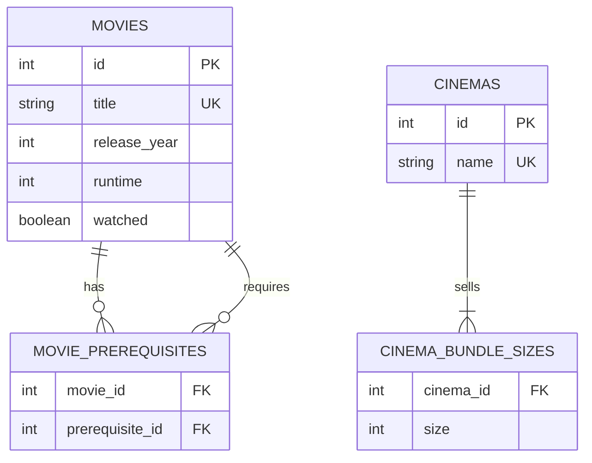

# Doomsday Ready

A small full-stack app for building an MCU rewatch list and finding exact opening-night cinema bundles.

## Stack

- React + TypeScript + Vite
- Node.js + Express + TypeScript
- Neon PostgreSQL (the standard PostgreSQL wire protocol, connected with `pg`)

## Run locally

1. Link and deploy the Neon project with the CLI. `neon deploy` writes `DATABASE_URL` (pooled app traffic) and `DATABASE_URL_UNPOOLED` (direct migrations) to `.env.local` when `.env` is absent.
2. Run `npm install` at the repository root.
3. Run `npm run db:migrate` to apply the checked-in schema migration over the direct connection.
4. Run `npm run dev` and open the Vite URL shown in the terminal (normally `http://localhost:5173`).

The API listens on port 3001 by default. Set `PORT` to change it. The Node API uses `pg` with Neon's pooled `DATABASE_URL`; migrations use the direct `DATABASE_URL_UNPOOLED`. The API loads `.env.local` and then `.env`. To point the client to another API origin, set `VITE_API_URL` in the client environment.

## Features

- Add, list, and update movies; mark them watched and maintain prerequisite links.
- Generate a prerequisite-first rewatch order with progress and remaining runtime.
- Add cinemas and calculate a minimum-bundle exact seat quote or report that no exact quote exists.

The prerequisite traversal, circular-dependency check, and minimum-bundle calculation use custom code in the API, without libraries that solve those problems.

## API

- `POST /api/movies` — `{ "title", "releaseYear", "runtime", "prerequisites"?, "watched"? }`
- `GET /api/movies`
- `PATCH /api/movies/:id` — updates movie fields, including `watched` and `prerequisites`
- `GET /api/movies/:id/rewatch-order`
- `POST /api/cinemas` — `{ "name", "bundleSizes": [2, 5] }`
- `GET /api/cinemas`
- `GET /api/cinemas/:id/booking?groupSize=6`

Circular prerequisites return HTTP `409` with code `CIRCULAR_DEPENDENCY`. Duplicate titles and cinema names return HTTP `409`.

## Data model

## Choices and notes

- Movie titles and cinema names are unique under PostgreSQL's default case-sensitive text comparison.
- The assessment does not specify a year range; this app accepts whole release years from 1888 through 3000.
- A rewatch order can use any valid order when multiple movies have no dependency ordering between them. The target movie is excluded.
- If multiple bundle combinations use the same minimum number of bundles, the quote uses the first minimum found by the dynamic-programming pass.
- AI assistance was used to scaffold and implement the application and README. The core algorithms are custom implementations, not solver-library calls; review and adapt them yourself to meet the assessment's own-work requirement.

## Production build

Run `npm run build` to build the API and client. `npm start` starts the built API. Deploy the static `client/dist` directory to a static host and set its API URL as `VITE_API_URL` at build time.
