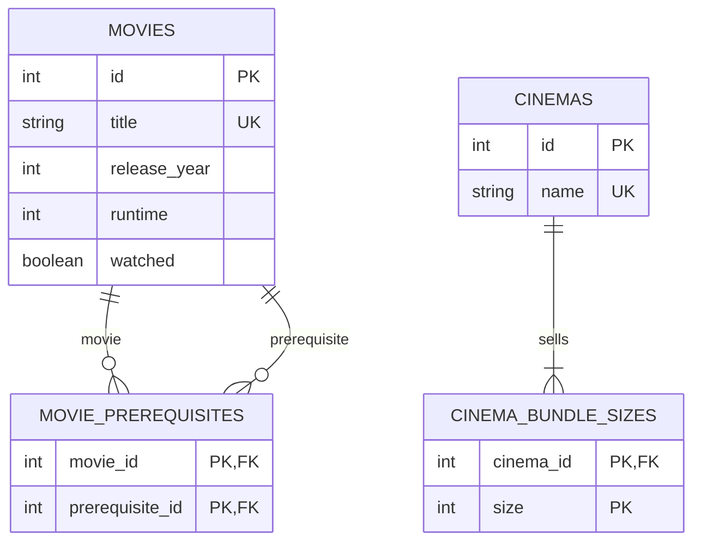

# Doomsday Ready

A movie rewatch planner and cinema bundle calculator built for the Blinto full stack assessment.

The client uses React, Vite, Tailwind CSS, and GSAP.

## Run it

Requirements: Node.js 20 or newer and an existing Neon PostgreSQL database.

1. Copy `.env.example` to `.env` and put your Neon connection string in `DATABASE_URL`. Use the Neon pooled connection string and keep SSL enabled (`sslmode=require`).
2. Install dependencies from the repository root with `npm install`.
3. Create the schema and insert the assessment sample movies with `npm run setup`.
4. Run `npm run dev` to start the API and Vite together. Open `http://localhost:5173/` for Movies, `/rewatch.html` for Rewatch Plan, and `/booking.html` for Booking. Each view is a separate page with full-page navigation. You can also start the API and frontend separately with `npm run dev:server` and `npm run dev:client`.
5. Run the logic and expected-results checks with `npm test`. Run the frontend production build with `npm run build`.

The API listens on port 3001. The Vite development server forwards `/api` requests to it. `npm start` starts the API outside development. The database remains on Neon.

## Assessment API

- `POST /api/movies` adds a movie.
- `GET /api/movies` lists movies.
- `PATCH /api/movies/:id` updates watched state, movie details, or prerequisites.
- `DELETE /api/movies/:id` deletes a movie if no other movie lists it as a prerequisite. It returns `409 MOVIE_IS_PREREQUISITE` otherwise.
- `GET /api/movies/:id/rewatch-order` returns its prerequisite-first plan.
- `POST /api/cinemas` adds a cinema and its bundle sizes.
- `GET /api/cinemas` lists cinemas and bundle sizes.
- `GET /api/cinemas/:id/booking?groupSize=6` returns an exact minimum-bundle quote or no-match result.

The rewatch traversal, cycle check, and bundle calculation are JavaScript implementations in `server/src/logic.js`; none relies on recursive SQL or a solver library. Circular dependencies return HTTP 409 with `CIRCULAR_DEPENDENCY`.

## Data model

## Assumptions

- The assessment gives no release-year limits or runtimes for its example movies. Whole years are accepted, and the sample runtime/year values are set in `server/src/sample-data.js` to make the rewatch plan and remaining-time display usable. The year 2026 and 180 minute runtime for *Avengers: Doomsday* are assumptions.
- Prerequisites can be changed when creating or editing a movie through the API. On the Movies view, you can select prerequisites when adding a movie and edit them later.
- If several valid prerequisite orders exist, the implementation returns a valid depth-first order. Bundle ties use the first minimum solution found by the dynamic program.
- Unique text values follow PostgreSQL's default case-sensitive comparison.
- Movie prerequisite foreign keys use `ON DELETE NO ACTION`; deleting a movie explicitly removes only its own prerequisite links after confirming no other movie depends on it. The database never cascades prerequisite-link deletion.

## AI tools

AI assistance was used to inspect the assessment, plan the implementation, draft code, and review the expected results. The graph traversal, cycle check, and bundle algorithm are explicit JavaScript written for this project.

## Docker Compose bonus

With `.env` configured, run `docker compose up --build`. The web UI is at `http://localhost:5173`; the API is at `http://localhost:3001`. Compose starts only the application containers. PostgreSQL stays on Neon.

## Deploy to Vercel with Docker

Live site: <https://doomsday-ready-one.vercel.app>.

The repository-root `Dockerfile.vercel` builds the Vite pages and serves them with the Express API in one Vercel container. Import the repository root (`.`) as one Vercel project and add `DATABASE_URL` to that project's Production environment variables. Keep Neon as the external database. The existing `docker-compose.yml` remains for local development; Vercel deploys the single HTTP container rather than Compose.
